<h1 align="center">
  Hello There
</h1>

  General Kenobi! You've stumbled upon my coding galaxy.  
  Don't worry, no Sith code here, just a bunch of C#, Nerdiness, and a sprinkle of the Force. 🌌✨

## Skills 🛠️

Here are the tools and programming languages I have worked with so far:

  

By now I had the chance to gain experience with a wide array of technologies. Currently, my primary focus is on C#, .NET, databases, and exploring game design as a hobby.

Through crafting a custom engine, I deepened my understanding of **WebGL**. My bachelor thesis, a WebGPU renderer for [Vega](https://vega.github.io/vega), got me into **WebGPU**, and I kept working on it long after the thesis. It now lives in the official Vega organization as [vega/vega-webgpu](https://github.com/vega/vega-webgpu) and is published on npm as [`vega-webgpu`](https://www.npmjs.com/package/vega-webgpu). My master's thesis stayed with WebGPU, this time natively in C++ as part of the [Vienna WebGPU Engine](https://github.com/hlavacs/Vienna-WebGPU-Engine).

## My GitHub Stats 📊

## My Coding Journey 🚀

I got into coding because of my love for Minecraft. I used to spend hours building crazy stuff with Redstone, and that got me curious about the tech side of things. So, I ended up at a computer tech school where I dived into coding, mainly with Java. That's when game development caught my eye, and I started creating small games using Unity and C#. They weren't super fancy, but I was proud of them.

Having graduated from an IT school in Vienna in 2021, I found my passion for C# among the array of tools and languages I encountered. In October 2021, I transitioned into an information technology bachelor's program, which I completed in February 2024. Right after, in March 2024, I started my master's, which I finished in August 2026. My master's thesis was part of the [Vienna WebGPU Engine](https://github.com/hlavacs/Vienna-WebGPU-Engine) project, a C++ render engine built with WebGPU, focused on learning, clean architecture, and real-time rendering.

Professionally, I'm knee-deep in the .NET world, working on cool projects. On the side, I'm still doing my game development thing or working on my own engine and smaller projects because, well, it's just too much fun to give up!

